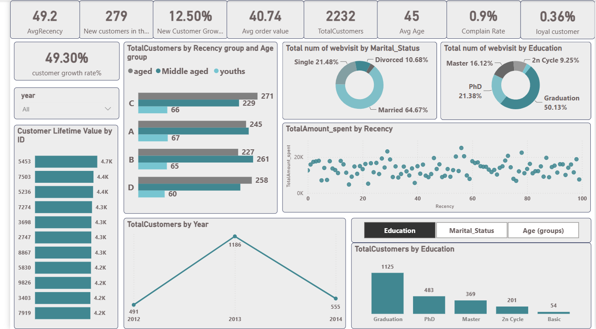
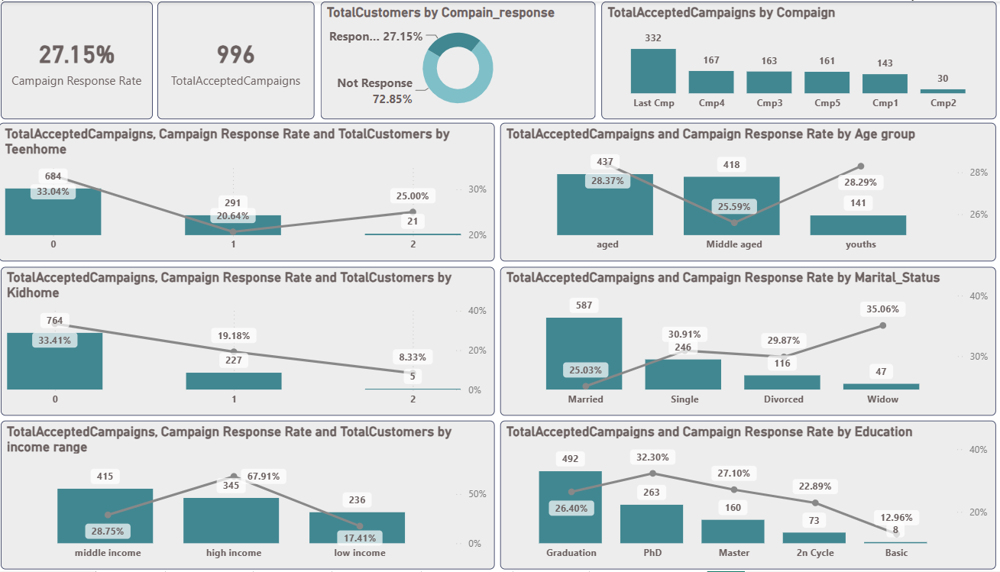
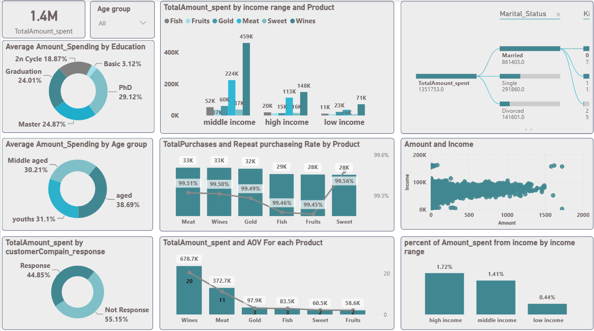
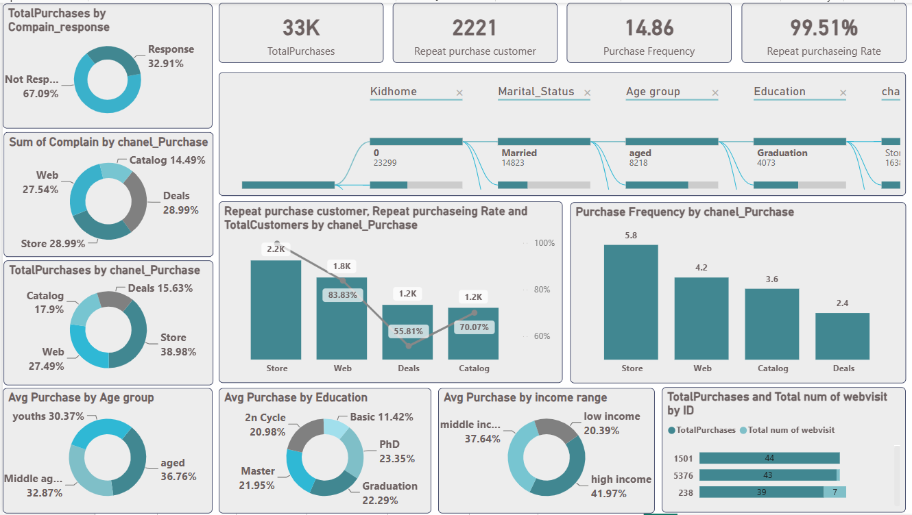
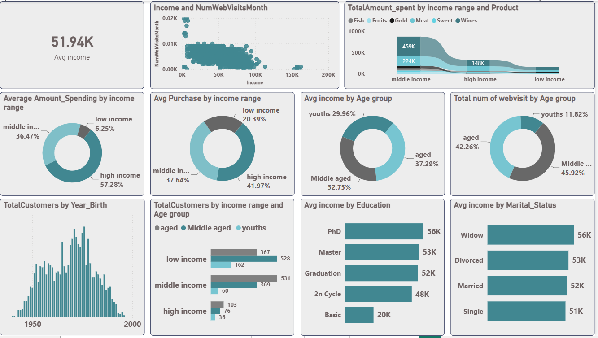
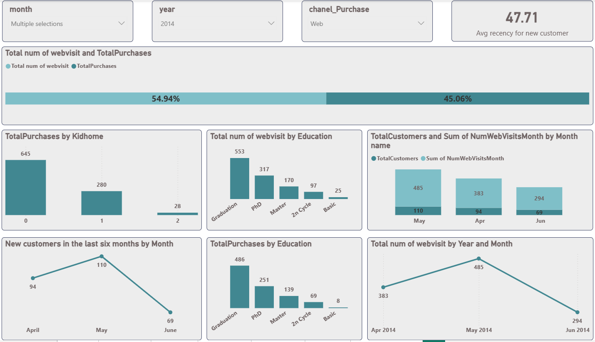
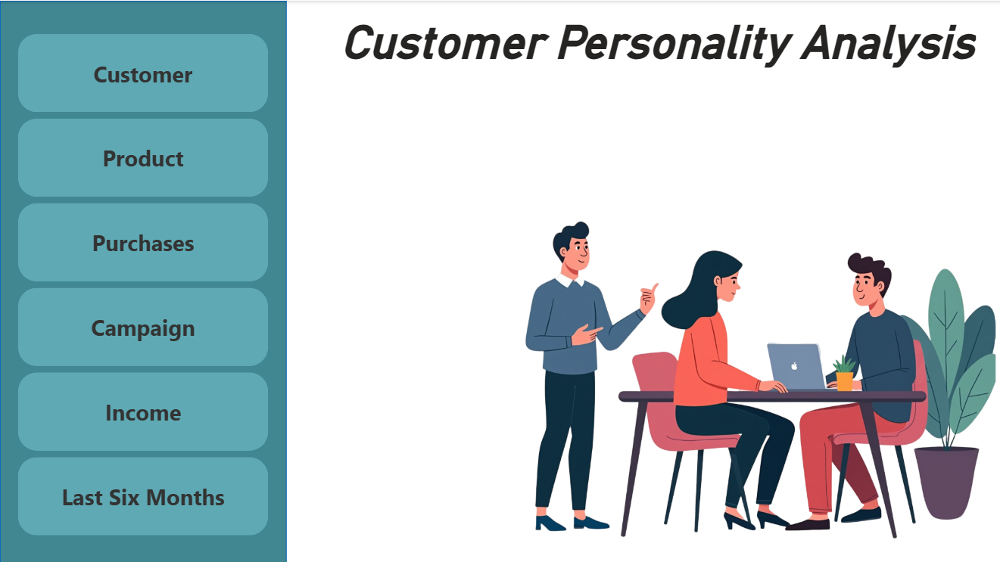

# Customer Personality Analysis

### Customer Segmentation | Marketing Analytics | Power BI & SQL

An end-to-end, team-based data analytics project developed as part of the **Digital Egypt Pioneers Initiative (DEPI)**.

The project explores customer demographics, purchasing patterns, product spending, and marketing campaign performance to generate actionable business insights.

---

## Project Overview

Understanding customer behavior is essential for effective marketing, customer retention, and business growth.

This project analyzes customer data to explore:

- Customer demographics and purchasing behavior
- Spending patterns across product categories
- Marketing campaign acceptance and customer responses
- Customer activity, recency, and loyalty indicators
- Performance across purchasing channels
- Customer segmentation by age, income, education, and marital status

**Objective:** Transform customer data into interactive business intelligence reports that support marketing and operational decision-making.

---

## Tools & Technologies

| Technology | Application |
|---|---|
| Power BI | Interactive dashboards and reporting |
| SQL | Data analysis and business queries |
| Power Query | Data cleaning and transformation |
| DAX | KPI calculations and analytical measures |
| Data Modeling | Relationships and analytical data structure |

---

## Project Workflow

### 1. Data Exploration & Cleaning

Explored the dataset and identified data quality issues, including:

- Missing income values
- Outliers and invalid entries
- Inconsistent marital status categories
- Inconsistent date formats

Used Power Query to clean and transform the data, standardize categories, and prepare it for analysis.

### 2. Data Modeling

Organized the data into related tables and designed an Entity Relationship Diagram (ERD) to support analytical reporting.

### 3. SQL Analysis

Developed SQL queries to investigate:

- Customer spending by demographic segment
- Product performance
- Purchasing channel activity
- Marketing campaign acceptance
- Customer recency
- Top-spending customers and products

Used SQL joins, aggregations, conditional logic, and window functions.

### 4. Power BI Development

Developed a multi-page interactive Power BI report featuring KPI cards, charts, slicers, and analytical visualizations.

---

## Dashboard Gallery

### Customer Analytics



Explores customer demographics, recency, age distribution, spending, and customer activity.

### Campaign Performance



Analyzes marketing campaign responses across demographic and income segments.

### Product Analytics



Examines product category spending, customer segments, and revenue distribution.

### Purchases Analytics



Explores purchasing channels, purchase frequency, and repeat purchasing indicators.

### Income Analytics



Analyzes customer income, purchasing patterns, and spending across income groups.

### Last Six Months Analysis



Explores customer activity, web visits, and purchasing trends over the reporting period.

### Home & Navigation



Provides navigation between the report's analytical pages.

---

## Selected Dashboard Metrics

The report displays the following values:

| Metric | Displayed Value |
|---|---:|
| Total Customers | 2,232 |
| Average Customer Age | 45 |
| Average Recency | 49.2 days |
| Average Order Value | 40.74 |
| Campaign Response Rate | 27.15% |
| Average Income | 51.94K |
| Total Product Spending | 1.4M |

**Note:** These are values displayed in the original Power BI report. Their interpretation depends on the report's measure definitions, dataset, and filter context.

---

## Business Insights

The analysis highlighted several areas for further business investigation:

**Customer Segmentation**
- Customer behavior and spending differ across demographic groups.
- Income and household characteristics provide useful dimensions for customer analysis.

**Marketing Campaigns**
- Campaign acceptance varies across customer segments.
- The latest campaign recorded the highest number of accepted responses in the documented analysis.

**Purchasing Behavior**
- Store, Web, Catalog, and Deals channels show different purchasing patterns.
- Comparing channel performance can help identify opportunities to improve customer engagement.

**Product Performance**
- Product categories make different contributions to overall spending.
- Product-level analysis can support more targeted commercial decisions.

---

## Business Recommendations

Based on the documented analysis:

1. Evaluate targeted marketing strategies for different customer segments.
2. Investigate opportunities to increase repeat purchases through lower-performing channels.
3. Explore personalized campaigns based on income, age, and household characteristics.
4. Analyze high-value customers to identify opportunities for retention and engagement.
5. Review successful campaign strategies before applying them to future marketing initiatives.

These recommendations represent analytical proposals rather than measured business outcomes.

---

## Repository Structure

```text
customer-personality-analysis-powerbi-sql/
|
|-- README.md
|-- Depi.pbix
|-- depi.sql
|
|-- documentation/
|   |-- Customer Personality Analysis Documentation.docx
|   |-- Customer Personality Analysis Project.pptx
|
|-- images/
    |-- home-dashboard.png
    |-- customer-dashboard.png
    |-- product-dashboard.png
    |-- purchases-dashboard.png
    |-- campaign-dashboard.png
    |-- income-dashboard.png
    |-- last-six-months-dashboard.png
```

---

## Project Files

- [Power BI Report](Depi.pbix)
- [SQL Analysis Scripts](depi.sql)
- [Project Documentation](documentation/Customer%20Personality%20Analysis%20Documentation.docx)
- [Project Presentation](documentation/Customer%20Personality%20Analysis%20Project.pptx)

Download the PBIX file and open it using Power BI Desktop to explore the interactive report.

---

## Project Team

This project was completed collaboratively as part of DEPI.

- Sayed Said Sayed
- Mohamed Moustafa Mahmoud
- Moataz Mohamed Fares
- Sadek Ali Sadek

**Supervisor:** Eng. Marwan Mokhtar

**Program:** Digital Egypt Pioneers Initiative (DEPI)

---

## Connect With Me

**Sayed Said**  
Data Analyst | Power BI Developer

[LinkedIn](https://www.linkedin.com/in/sayed-said/) | [GitHub](https://github.com/Sayed-said93)

*Turning Data into Actionable Insights.*
